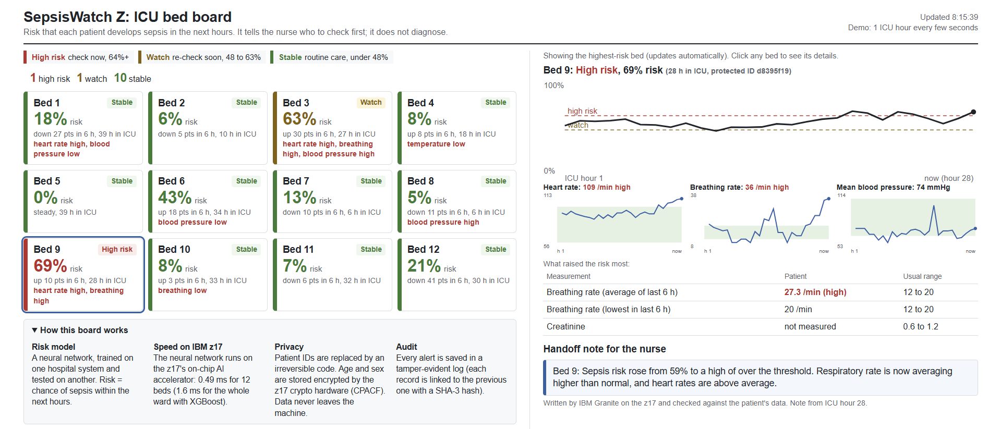
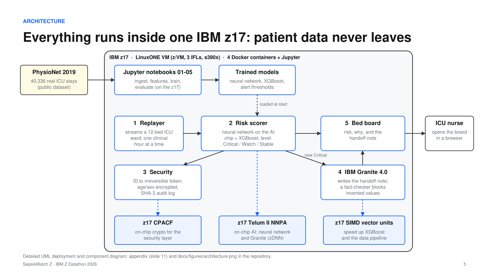
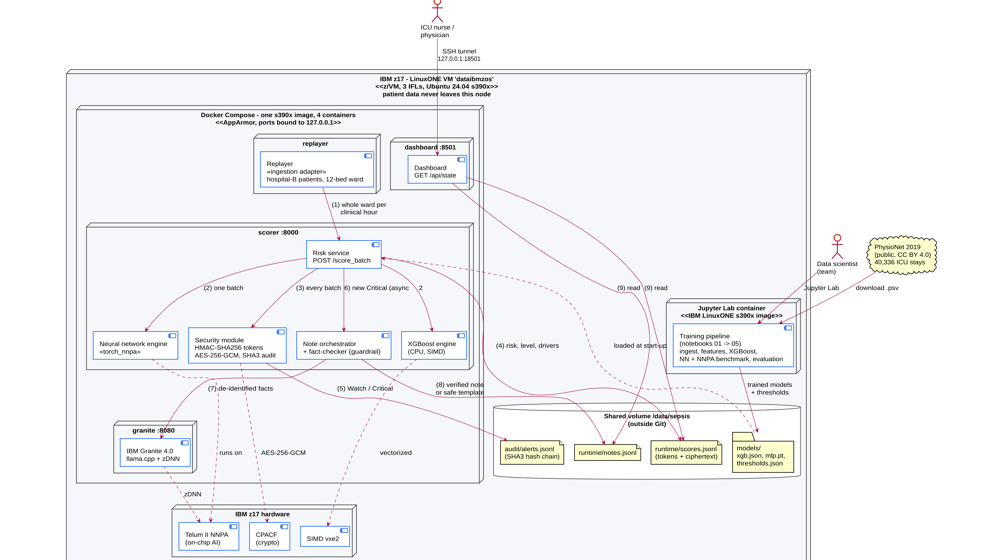

# SepsisWatch Z

Early sepsis warning for the ICU, running entirely on an IBM z17 mainframe.
Every patient is scored every hour. The nurse sees who to check first, why, and a short handoff note, and patient data never leaves the machine.

IBM Z Datathon 2026. Theme 1: Real-Time AI for Critical Decisions, with elements of Theme 2: AI Secured. Event code SSF2026.

- Demo video: [watch on Google Drive](https://drive.google.com/file/d/13WzqOCzfd34phnHl0JXDJjZPALc0JetP/view?usp=sharing)
- Pitch deck: [docs/SepsisWatchZ_pitch_deck.pdf](docs/SepsisWatchZ_pitch_deck.pdf)



## The problem

- Sepsis causes about 11 million deaths a year, roughly 1 in 5 deaths worldwide, and every hour of delayed treatment matters.
- In the ICU the early signs are subtle and spread across dozens of vital signs and lab values.
- The screening rule used today, SIRS ≥ 2, is very noisy. On real data it kept patients without sepsis in alarm 24% of the time, so nurses stop trusting the alarms.
- Health data is sensitive, so hospitals cannot simply send it to a public cloud AI service.

## Our solution

A live ICU bed board that scores every patient every hour and shows, for each bed:

| What the nurse sees | Details |
|---|---|
| Risk level | High risk, Watch or Stable, with the risk score and its 6-hour trend |
| Why | The measurements that raised the risk most, next to their usual range |
| Handoff note | Written by IBM Granite on the z17 and checked against the patient's data before it is shown |
| Privacy | Patient IDs replaced by tokens, age and sex encrypted with CPACF, every alert stored in a tamper-evident audit log |

SepsisWatch Z supports clinicians. It does not diagnose, and clinicians always decide.

## Results on a hospital the model never saw

We trained on hospital A and tested on hospital B of the public PhysioNet 2019 dataset (40,336 real ICU stays, 1.55 million patient-hours).

| | Sepsis patients alerted (up to 12 h before onset) | Time in alarm for patients without sepsis | New false alarms per patient-day |
|---|:---:|:---:|:---:|
| SIRS ≥ 2 (current practice) | 75% | 24% | 1.32 |
| SepsisWatch Z | 55% | 8% | 0.49 |

- One third of the alarm time and 63% fewer new false alarms than SIRS.
- Tuned to a detection level close to SIRS (68%), it still spends 40% less time in alarm.
- Detection is similar for women and men (1.7 points apart) and across age groups.
- On the Telum II on-chip AI accelerator (NNPA), a 12-bed ward is scored in about 1.5 ms, and the whole test hospital (762,000 patient-hours) is scored 12 times faster than on the CPU, with 99.98% identical decisions.

Full tables, fairness and figures: [docs/results.md](docs/results.md)

## How it works



<details><summary>Detailed UML deployment and component diagram</summary>



</details>

1. Train: five Jupyter notebooks on the z17 ingest the data, build 140 hourly features, train XGBoost and a neural network, and evaluate them.
2. Stream: a replayer sends a 12-bed ward to the scorer every clinical hour.
3. Score: XGBoost and a neural network running on the NNPA produce the risk level and the reasons behind it.
4. Explain: when a patient becomes high risk, IBM Granite (llama.cpp with zDNN) drafts a note, and a fact-checker rejects anything that is not in the data.
5. Show: the dashboard reads the stored results, and the nurse opens it through an SSH tunnel.

UML source: [docs/architecture/](docs/architecture/)

## IBM Z features we use

| IBM Z capability | What it does in SepsisWatch Z |
|---|---|
| Telum II NNPA (on-chip AI) | Runs the neural network that decides the alerts |
| zDNN | Runs IBM Granite locally for the handoff notes |
| CPACF (hardware crypto) | AES-256-GCM encryption of sensitive fields and the SHA-3 audit chain |
| SIMD vector units | Fast XGBoost and data processing |
| z/VM and containers | Four isolated Docker services on s390x, with no ports exposed to the internet |

## Run it on the LinuxONE VM

```bash
git clone https://github.com/HemsyCA/DATAIBMZOS-IBM-Z-Datathon-2026.git
cd DATAIBMZOS-IBM-Z-Datathon-2026
bash scripts/make_env.sh          # creates .env with the keys (never committed)
docker compose up -d --build      # replayer, scorer, granite, dashboard
curl -s localhost:18000/health    # should show "device": "nnpa" and "encryption": true
```

Open the dashboard from your laptop through an SSH tunnel:
`ssh -N -L 8501:localhost:18501 linux1@<vm-ip>`, then go to http://localhost:8501 (the VM port is set by `DASHBOARD_HOST_PORT` in `.env`).

To rebuild the models, run `notebooks/01` to `05` in Jupyter Lab. More details in [services/README.md](services/README.md).

## Repository layout

```
notebooks/        5 notebooks, executed on the IBM z17 with their outputs
services/         scorer, replayer, granite and dashboard (FastAPI)
security/         tokens, encryption (CPACF) and the hash-chained audit log
data/             script to download PhysioNet 2019 (the data stays on the VM)
docs/             results, figures, architecture and pitch deck
docs/evidence/    screenshots from the z17 and the two IBM labs
```

## Responsible AI

- Alert thresholds limit false alarms to about one per patient-day, to reduce alarm fatigue.
- Explanations use physiology only, and the language model never receives patient identifiers.
- The output is a risk score, not a diagnosis. It was validated on a public 2019 benchmark, and the next step is local validation with each hospital's own data.

## Built with

[PhysioNet 2019](https://physionet.org/content/challenge-2019/1.0.0/), Python, NumPy, pandas, scikit-learn, XGBoost, PyTorch with IBM `torch_nnpa`, FastAPI, llama.cpp with zDNN, [IBM Granite 4.0](https://huggingface.co/ibm-granite), OpenSSL and Docker.

## Team

Hemsy, Jhojan, Misael and Miguel. Built during the IBM Z Datathon, October 17 and 18, 2026.
